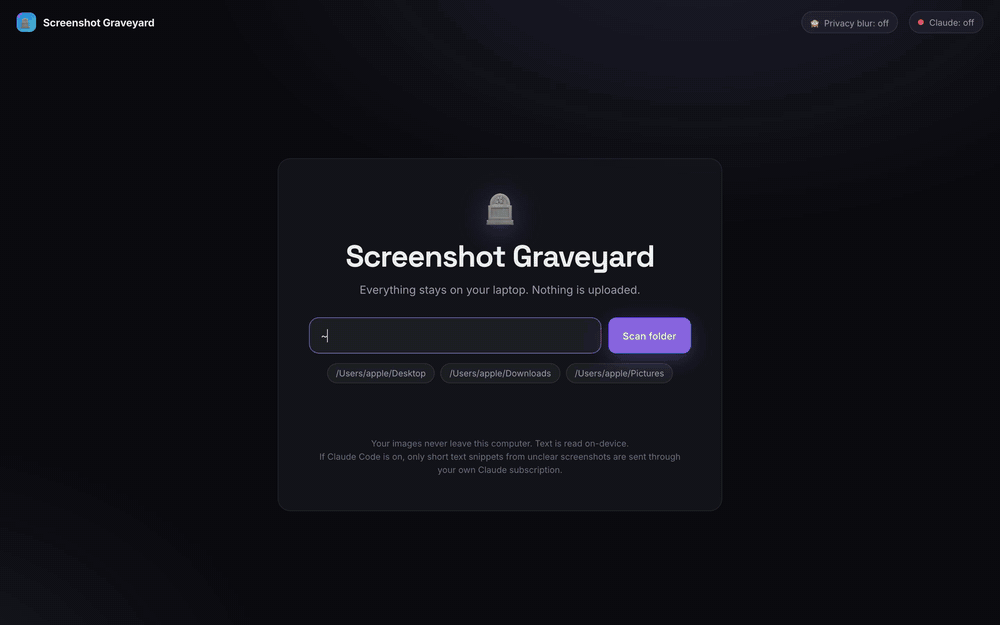
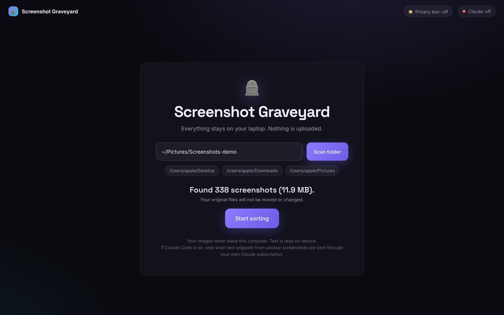
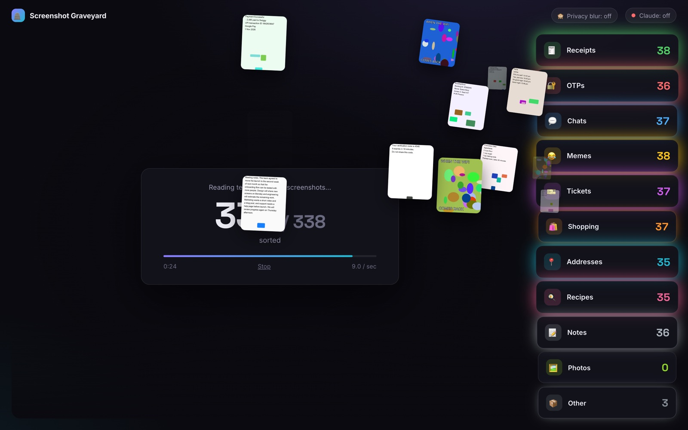
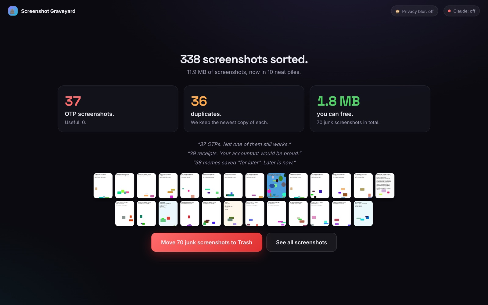
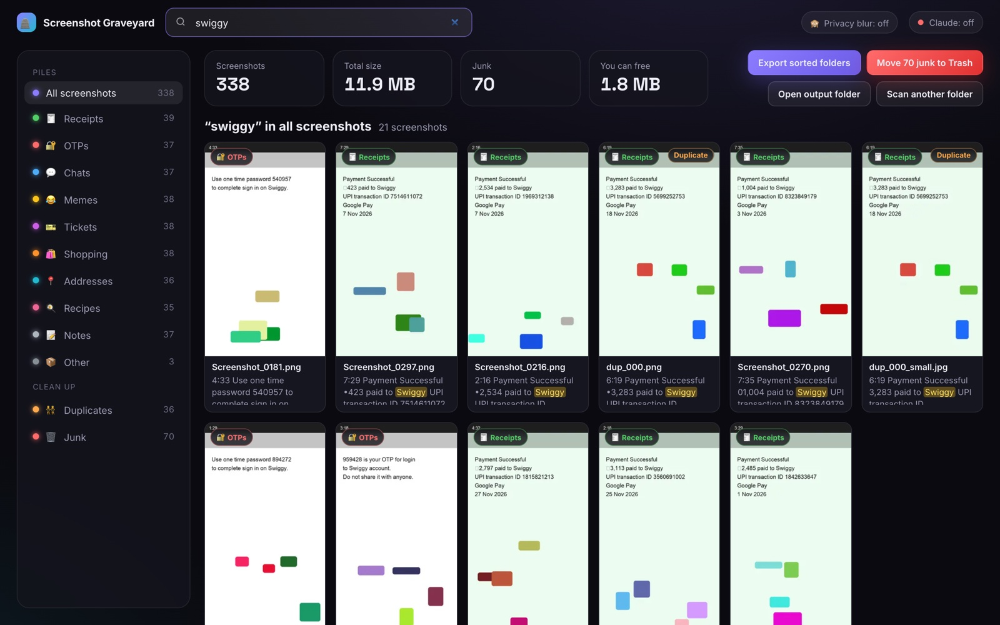

# 🪦 Screenshot Graveyard

**Turn thousands of forgotten screenshots into sorted, searchable folders, all on your own computer.**

Point it at a folder of screenshots. It reads the text inside each one, sorts them into piles (Receipts, OTPs, Chats, Memes, Tickets, Shopping, Addresses, Recipes, Notes, Photos, Other), finds duplicates and junk, and lets you search for anything you ever screenshotted ("Swiggy", "PNR", "that address Rohan sent").



<sub>The demo uses fake, generated screenshots, not real ones.</sub>

## What it looks like

| | |
|---|---|
|  |  |
| **1. Pick a folder.** It counts your screenshots and never changes the originals. | **2. Watch it sort.** Every screenshot flies into its pile as its text is read. |
|  |  |
| **3. See what you've been hoarding.** Old OTPs, duplicates, and how much space you can free. | **4. Search the text inside every screenshot.** Find that Swiggy receipt or PNR in a second. |

## Features

- **Local-first.** Your images never leave your computer. No accounts, no paid APIs.
- **Reads the text** in every screenshot (Apple Vision on macOS, Tesseract on Windows and Linux).
- **Sorts automatically**, using keyword rules first, then a local image model (OpenCLIP), then optionally your own Claude.
- **Full-text search** across everything, with highlighted matches.
- **Finds duplicates and junk**, such as old OTPs and near-identical copies, and shows how much space you can free.
- **Exports sorted folders** as copies. The original files are **never modified**.
- **Moves junk to `_Trash`** inside the output folder, after asking you first. Nothing is ever deleted.
- **Privacy blur** for thumbnails and text, handy when sharing your screen.
- **Fast re-runs.** Already-sorted screenshots are skipped, and an interrupted run picks up where it stopped.

## Start here (no coding needed)

You need a computer (Mac, Windows or Linux) and a Claude plan.

**1. Install Claude Code** from [claude.com/claude-code](https://claude.com/claude-code). Then open the **Terminal** app (Mac: press `⌘ Space`, type *Terminal*, press Enter. Windows: open *PowerShell*), type `claude` and press Enter.

**2. Paste this to Claude:**

```
Set up and open https://github.com/VarunSaini23/screenshot-graveyard-claude
```

Claude downloads it, installs everything and opens the app in your browser.

**3. In the app:** paste or pick your screenshots folder, click **Scan folder**, then **Start sorting**. The first sort downloads a ~600 MB image model once. After that it works offline.

## Using it again

While it's running, the app lives at **http://localhost:8765**. To open it again later, either:

- double-click **Open Screenshot Graveyard** in the `screenshot-graveyard` folder in your home folder (`.command` on Mac, `.bat` on Windows), or
- tell Claude "open screenshot graveyard".

## Running it by hand

```bash
git clone https://github.com/VarunSaini23/screenshot-graveyard-claude ~/screenshot-graveyard
cd ~/screenshot-graveyard
./run.sh                                             # macOS / Linux
powershell -ExecutionPolicy Bypass -File .\run.ps1   # Windows
```

The script creates a virtual environment, installs everything, starts the app and opens **http://localhost:8765** in your browser. If that port is busy, it uses the next free one and prints the address. If it's already running, it just opens the page.

### Requirements

- macOS 13+ or Windows 10/11 (Linux works too)
- Python 3.11 or newer
- **Windows/Linux only:** Tesseract OCR
  - Windows: `winget install UB-Mannheim.TesseractOCR`
  - Linux: `sudo apt install tesseract-ocr`
- About 1 GB of free disk space for the image model, which downloads once (~600 MB) on first use

## Getting your screenshots onto the computer

- **iPhone → Mac:** In Photos, open **Albums → Screenshots**, select all, and drag them to a folder. Or use AirDrop.
- **iPhone → Windows:** Plug in the phone, open **Photos → Import**, or copy the files from `This PC → Apple iPhone → DCIM`.
- **Android:** Plug in the phone over USB (choose *File transfer*) and copy `Pictures/Screenshots` (or `DCIM/Screenshots`) to your computer. Google Photos → download also works.

## How it works

1. **Scan** finds every image in the folder, including subfolders.
2. **Read** extracts the text (OCR), makes a thumbnail, and records a perceptual hash.
3. **Sort** applies keyword rules (for example "PNR" → Tickets, "UPI" → Receipts). Anything left unclear goes to OpenCLIP, a local image model, and optionally to your own `claude` CLI.
4. **Clean up** groups duplicates by perceptual hash and flags junk: expired OTPs and extra copies.
5. **Export** copies each screenshot into `Screenshot Graveyard Output/<Category>/`, next to the folder you scanned.

All data lives in `~/.screenshot-graveyard/` (an SQLite database with full-text search, plus thumbnails).

### Optional: Claude

If the [`claude`](https://docs.anthropic.com/en/docs/claude-code) CLI is installed and signed in, the app uses it for screenshots the rules and image model aren't sure about. Only a **short text snippet** (never the image) is sent, through *your own* Claude account. The badge in the top-right shows whether Claude is on. Set `SG_CLAUDE=0` to turn it off.

### Settings (environment variables)

| Variable | What it does | Default |
|---|---|---|
| `SG_PORT` | Port to start on (the next free one is used if it's busy) | `8765` |
| `SG_NO_BROWSER` | `1` = don't open the browser automatically | off |
| `SG_HOME` | Where the database and thumbnails live | `~/.screenshot-graveyard` |
| `SG_OUTPUT` | Where sorted folders are exported | `<scanned folder's parent>/Screenshot Graveyard Output` |
| `SG_WORKERS` | Parallel workers for reading images | based on CPU count |
| `SG_OCR` | `tesseract` to force Tesseract on macOS, `none` to skip OCR | auto |
| `SG_OCR_LANG` | Tesseract languages, e.g. `eng+hin` | `eng` |
| `SG_DISABLE_CLIP` | `1` = skip the image model (rules only) | off |
| `SG_CLAUDE` | `0` = never use Claude | auto |

## Privacy

- Images are processed **only on your computer**.
- Nothing is uploaded, and there's no telemetry.
- The only thing that can leave your machine is a short OCR text snippet, and only if you have your own `claude` CLI signed in. Set `SG_CLAUDE=0` to stop even that.
- The image model is downloaded once from Hugging Face and then runs offline.

## Uninstall

Delete the `screenshot-graveyard` folder and `~/.screenshot-graveyard/`. To remove the cached image model too, delete the OpenCLIP folders under `~/.cache/huggingface/`.

## Running the tests

```bash
.venv/bin/python -m pytest -q          # macOS / Linux
.\.venv\Scripts\python -m pytest -q    # Windows
```

To make realistic fake screenshots for trying it out:

```bash
python tools/make_samples.py samples --n 300
```

## Known limitations

- Memes whose captions OCR can't read may land in **Other**.
- Very small text on very large images may not be readable.
- Blank or nearly blank images get a best guess from the image model.
- The first image-model download is ~600 MB. Afterwards the app works fully offline.
- OCR is English by default. Add languages with `SG_OCR_LANG`, after installing the matching Tesseract language packs.

## Credits

- [OpenCLIP](https://github.com/mlfoundations/open_clip) and [LAION](https://laion.ai/) for the image model
- [Tesseract OCR](https://github.com/tesseract-ocr/tesseract)
- Apple Vision via [ocrmac](https://github.com/straussmaximilian/ocrmac)
- [FastAPI](https://fastapi.tiangolo.com/), [Pillow](https://python-pillow.org/), [imagehash](https://github.com/JohannesBuchner/imagehash)

## License

MIT. See [LICENSE](LICENSE).
